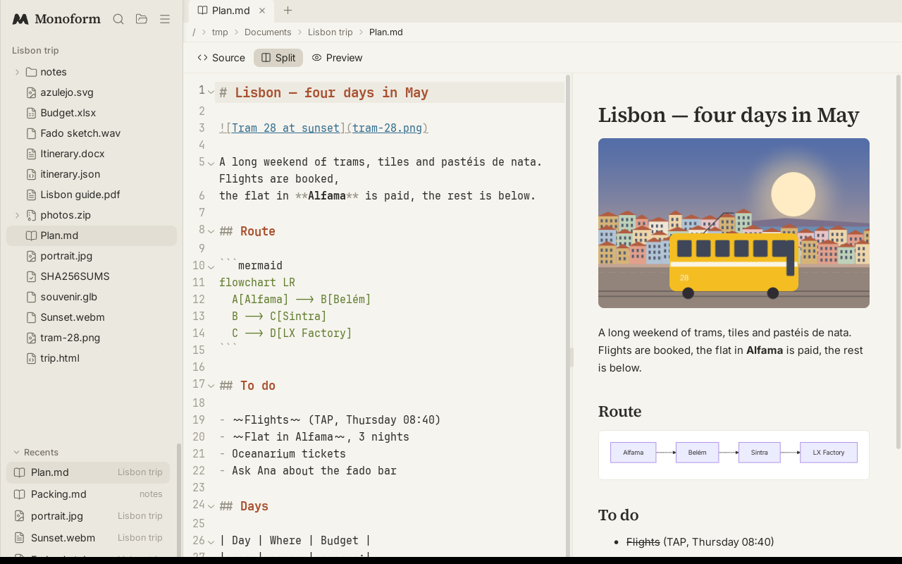
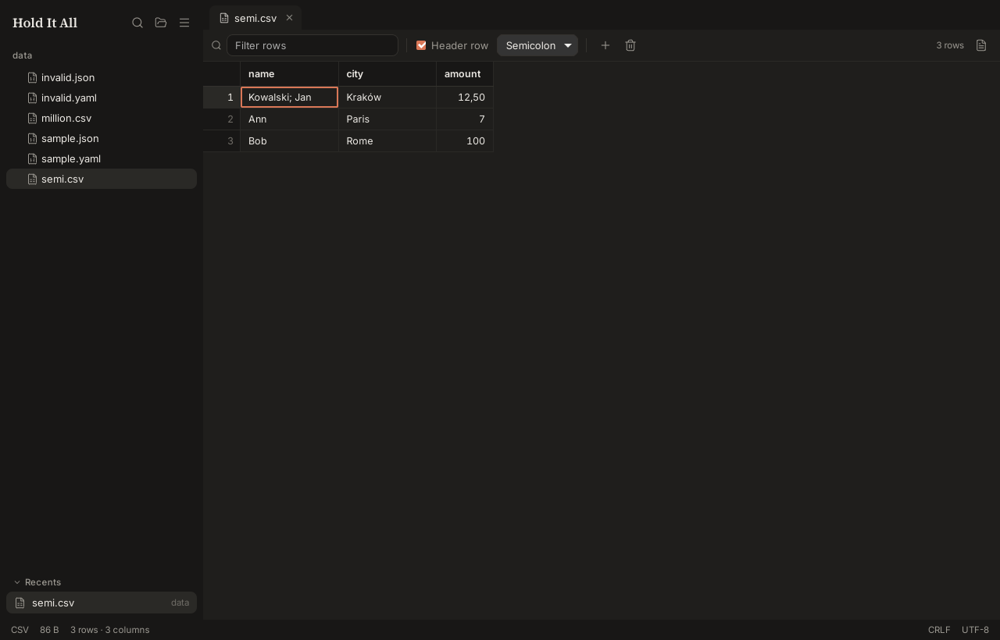
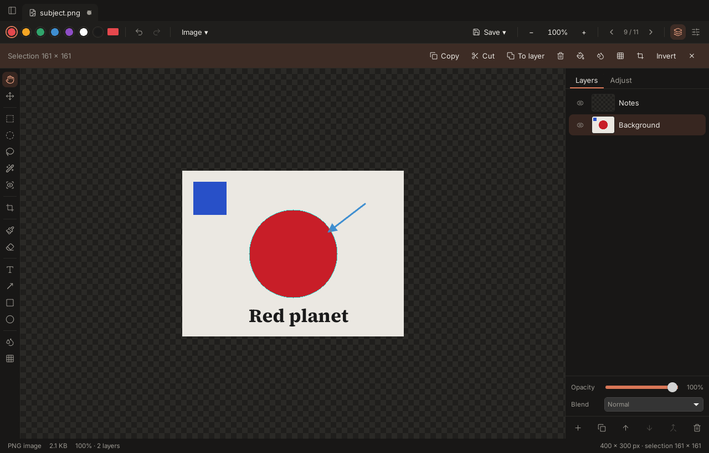
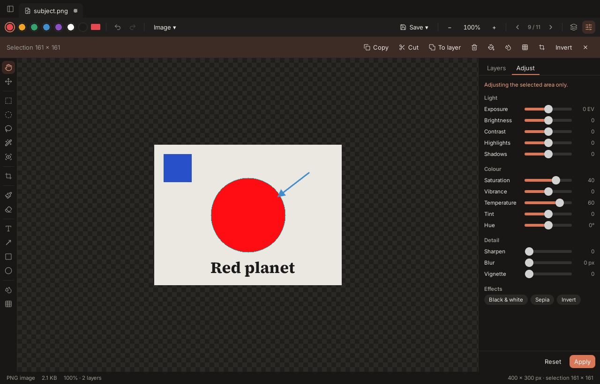
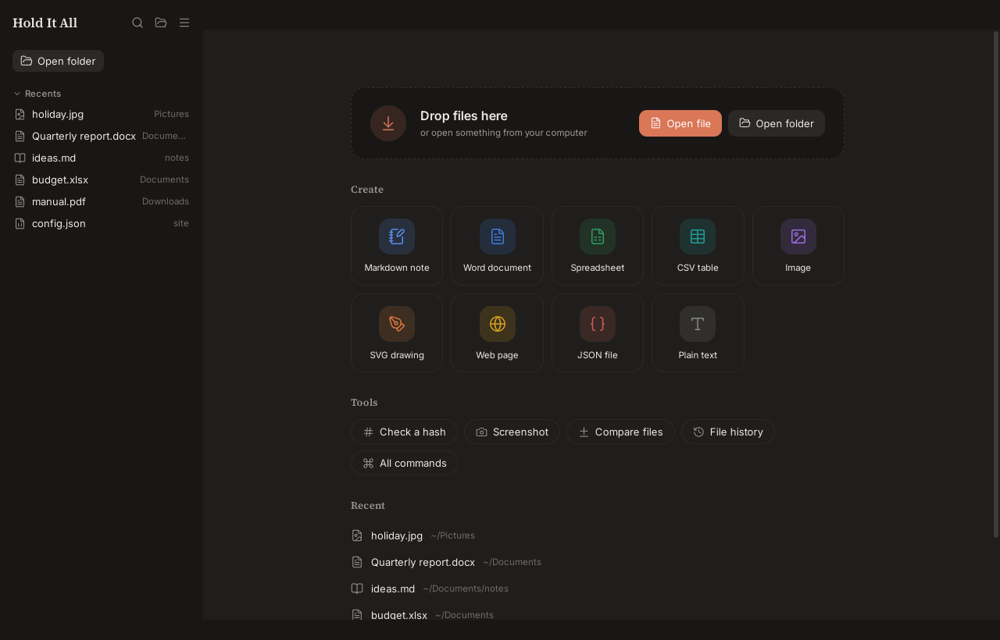
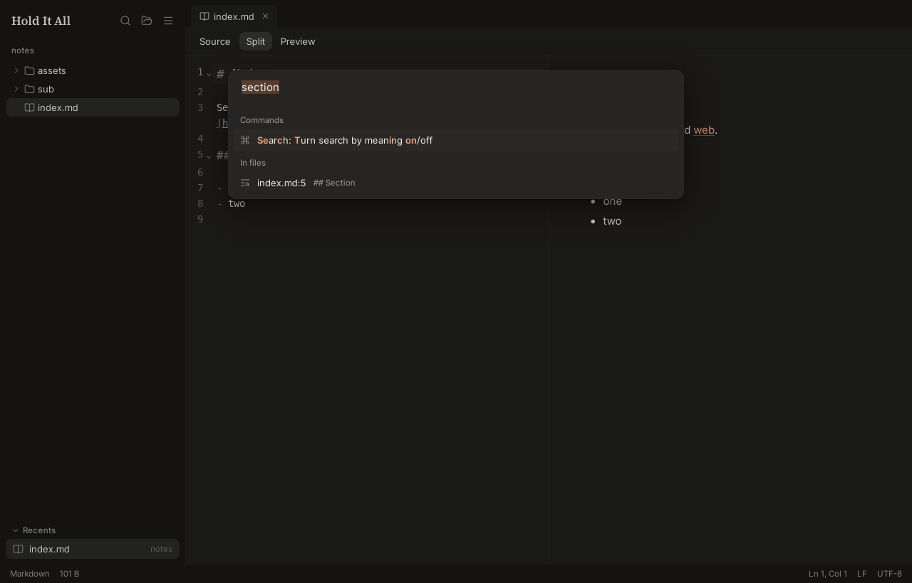
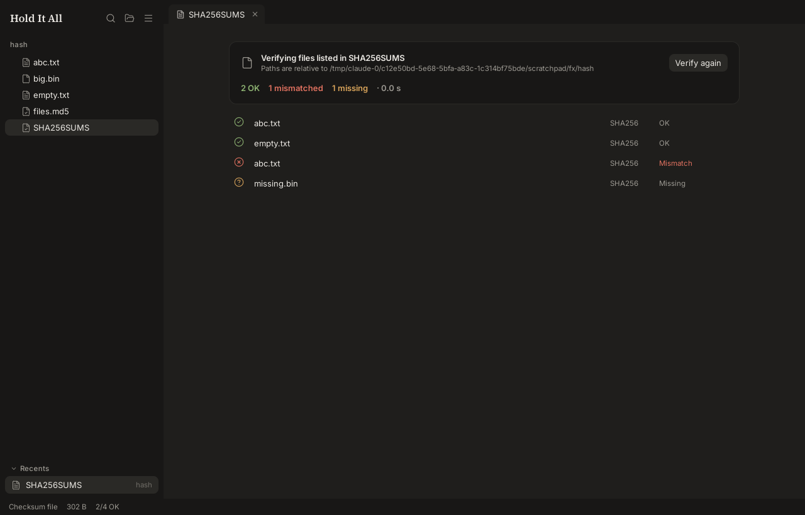
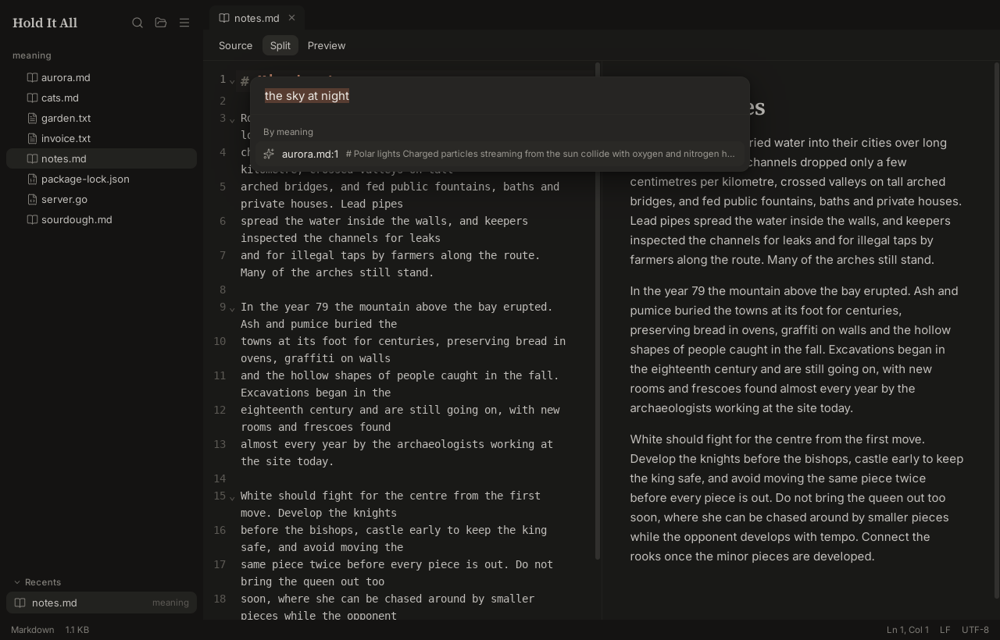
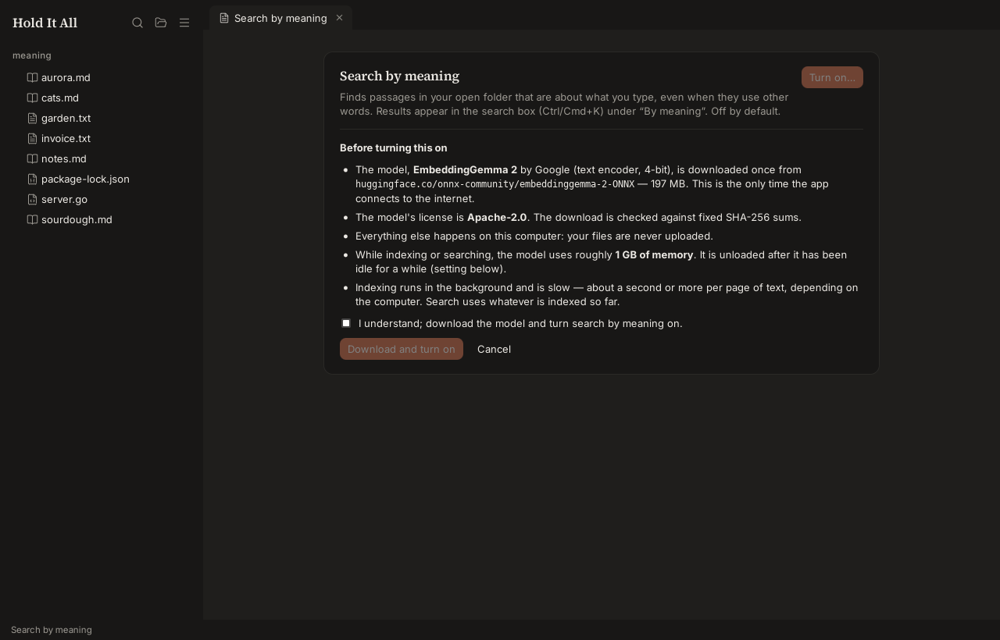

<p align="center"></p>

# Monoform

**A free, open-source, AI-generated everyday tool — a real-world alternative to the pile of small apps you open
files with.** One fast desktop window for notes and Markdown, PDFs, images, SVG and web pages, 3D models, music and
other audio, videos, JSON/YAML/CSV, Word, Excel and OpenDocument files, archives, and file hashes. It runs on Windows,
macOS and Linux, works offline, collects no telemetry and needs no account, and saves everything as plain files.

Monoform is written by AI (Anthropic's Claude, directed and reviewed by its maintainer) and released under permissive
licences only.



## What it does

| | |
|---|---|
| **Text & Markdown** | Code editor with Sublime-style editing — minimap, Go to symbol (Ctrl+R), multiple cursors (Ctrl+D, Ctrl+Alt+↑/↓, Ctrl+Shift+L), select/duplicate/join/sort lines, case changes, auto-closed brackets, word completion, indent guides — and byte-exact round-trips across encodings and line endings, find/replace, split/preview Markdown, image paste into `assets/`, folder search. |
| **PDF** | Fast viewer with search and thumbnails; highlight, text and drawing annotations in any colour; form filling; sign (draw, type or import a signature, place and resize it); redact for real (boxes or every search match); compress; reorder, rotate, delete, extract, merge, split; export pages as images; create a PDF from images or add images as pages; read the text of scanned pages (OCR) and make scans searchable. |
| **CAD drawings** | DXF viewer and light editor: layers, blocks, hatches, splines, texts; select (window/crossing), measure, draw lines, polylines, rectangles, circles, arcs and text, move/copy/rotate/scale, object snaps, grid, ortho, typed coordinates (`@dx,dy`, `len<angle`); edit properties; saves only what changed; export SVG/PNG. |
| **Data & logs** | JSON, YAML, TOML, XML and JSON Lines as a tree with validation (and as a table for lists of records); log files with coloured levels, level counts, filters, next error and live follow (tail -f). |
| **Config & certificates** | INI, .properties and .env as an editable table (duplicates flagged, secrets masked); certificates and keys (PEM, DER, PKCS#12, PKCS#7, CSR): issuer, expiry, names, fingerprints, chain. |
| **Databases** | SQLite files: browse tables and views (100k+ rows), sort, search, filter with WHERE, edit cells and rows with Save/Revert in one transaction, see the structure, run SQL with completion, export CSV. |
| **Compare** | Any two files side by side: text and code with word-level changes and change navigation; JSON/YAML as a list of changed paths; CSV rows matched by key; images by swipe, onion skin or a pixel difference; other files byte by byte. |
| **Workspace** | Split view: 2–4 tabs side by side (Ctrl+\\, the split button, or drag a tab onto a view's edge); interface size 80–200 % (Ctrl+Alt+= / −). Every view fits narrow panes: toolbars drop to icons (names on hover) and side panels float over the content. Drag the divider between source and preview (Markdown, HTML, diagrams, SVG) or between split tabs; double-click for equal sizes. The ☰ menu groups commands into submenus (New, This file, the open file's own commands, View, Split view…); Ctrl/Cmd+K finds any command by name. Tabs: **+** for a new tab, drag to reorder, drag a tab out of the window to give it a window of its own. Pictures and text move between tabs: copy and paste, or drag them from one view onto another (a picture or a video frame onto a video, an image, a note or an SVG). A short welcome on first start lets you pick the look (Help › Welcome shows it again). |
| **File history** | Every save keeps the earlier version: `Ctrl+Alt+Y` lists a file's versions to open, compare with the file now, or restore (undoable); *File history: all files* finds deleted files too. Stored locally, size-limited (Settings → File history). |
| **Images** | Layered editor: transparency, selections (rectangle, lasso, magic wand, click an object, select subject — edges snapped to the pixels) with copy/paste, brush/eraser, text in any installed font, free rotation, colour adjustments and seven kinds of blur (all limited to a selection), layer masks (hide parts of a layer without erasing them; paint, invert, from a selection), one-click background removal, **remove an object and fill the gap** (optional model), "save a copy", layers saved as OpenRaster (.ora); copy the text out of a screenshot or photo (OCR, offline), or out of just a selected part, and hide it (pixelate every word) in one click; colour picker with HEX/RGB/HSL and the image's palette (copy as CSS, save as .gpl). |
| **More images** | HEIC/HEIF and AVIF (through the system's decoder; convert to JPG/PNG); animated GIF and WebP frame editor (timing, reorder, delete, reverse, loop) saving GIF or WebP; ICO/ICNS viewer and maker; font preview (TTF, OTF, WOFF, WOFF2) with metadata, sizes and character map. |
| **SVG & web pages** | Edit SVG visually (select, move, scale, rotate, draw rectangles, ellipses, lines, freehand and text, change colours and any attribute, arrange, outline) or as source with a live preview — visual edits change only the affected attributes in the source; export PNG at any size; open HTML files in a safe preview (scripts and internet content off until you allow them) next to their source. |
| **3D models** | glTF/GLB (incl. Draco), FBX, OBJ+MTL, STL, PLY, 3MF, Collada, 3DS, USDZ, VRML, AMF, PCD, XYZ, VTK — orbit view, clickable animation list with play/pause/scrub/speed, wireframe and lighting toggles, floor grid, PNG snapshot. |
| **Audio** | Play MP3, WAV, FLAC, OGG (and Opus/AAC where the system can) with cover art and tags; waveform editor: select, cut/copy/paste, delete, trim, silence, fade in/out, volume, normalize, undo; save as WAV or FLAC — or as MP3 without re-encoding after cuts. |
| **Video** | Play MP4, MOV, WebM and MKV (whatever the system can decode) with a thumbnail timeline, frame stepping, speed, A–B loop, full screen and PNG snapshots; cut out parts, trim, rotate (MP4/MOV), remove or extract the audio — saved without re-encoding, so instantly and without quality loss. Effects: image overlays and area blurs (ellipse, rectangle or any drawn shape, optionally inverted; overlays can be masked too) animated with keyframes and timing curves (or pinned to a moving object by tracking), speed changes, transitions and fades, previewed live and rendered to WebM. |
| **Data** | JSON/YAML trees with exact error positions; CSV/TSV grid that stays smooth at a million rows, with sort, filter and Excel-style editing: range selection, copy/paste with Excel, drag to move, fill handle, AutoComplete, undo. |
| **Word & Excel** | Edit `.docx` and `.xlsx` in place (formulas recalculate; the same Excel-style grid as CSV). OpenDocument `.odt`/`.ods` (LibreOffice) edit and save as themselves, keeping their styles, notes, pictures and comments. Legacy `.doc`/`.xls` open too and save as `.docx`/`.xlsx`. |
| **Screenshots** | Take a screenshot of an area (`Ctrl+Shift+X`), the whole screen or after 3 seconds; it opens ready to mark up with arrows, boxes and text, blur or pixelate faces and passwords. Pick a colour from anywhere on the screen. |
| **Diagrams** | Graphviz `.dot` and Mermaid `.mmd` with the source beside the drawing (click a shape to find its line, export SVG/PNG); Mermaid and Graphviz blocks drawn inside Markdown previews. Excalidraw and draw.io drawings open on a canvas you can edit: move, resize, draw shapes, connect them with arrows, freehand, text, colours, pages, undo, SVG/PNG export. |
| **Archives** | Browse ZIP, TAR(.gz/.bz2/.xz/.zst), 7z and RAR like folders, open files inside, extract safely, create ZIPs. Packages and disk images too: .deb, .rpm, .iso, .msi (with their package details), and .jar/.apk/.ipa/.whl/.nupkg/.vsix/.msix and other zip-based packages. |
| **Hashes** | MD5, SHA-1, SHA-256, SHA-512, BLAKE3 in one pass; paste-to-compare; verify `SHA256SUMS`/`.md5` files. |
| **Search everything** | Ctrl/Cmd+K finds commands, file names and text inside files. An optional **search by meaning** (off by default) runs the EmbeddingGemma 2 model locally on your computer. |

Everything is keyboard-reachable: press **Ctrl+K** (**⌘K** on macOS) and type.

| | |
|---|---|
|  |  |
|  |  |
|  |  |
|  |  |
|  |  |
|  |  |
|  |  |
|  |  |
|  |  |

## Install

Download the latest version from the repository's **Releases** page (each release lists SHA-256 checksums in `SHA256SUMS`). Builds of unreleased commits are under **Actions → Build → a run → Artifacts**.

- **Windows:** `monoform-amd64-installer.exe` — Monoform's own setup, in the app's look. It installs for you
  (no administrator needed; *For everyone* is an option), and has an **unchecked** option to make Monoform the
  default app for its file types. Without it, the app is still listed under *Open with*. Uninstalling (Settings ›
  Apps) restores the previous defaults. There is also a portable `.zip`. The app uses the WebView2 runtime, which
  the setup installs if it is missing.
- **macOS:** `monoform-macos-universal.zip` contains `Monoform.app` for Apple Silicon and Intel. The build
  is not signed, so the first time, right-click the app and choose **Open**. The app declares its file types at the
  lowest rank, so it appears in *Open With* but never takes over a default. To make it the default, use
  *Get Info → Open with → Change All*.
- **Linux:** `monoform-linux-amd64.tar.gz`. Unpack it and run `./install.sh` to install into `~/.local`, with
  no root needed. The app then appears in *Open With* menus. `./install.sh --set-default` also makes it the default
  for its file types, and `./install.sh --uninstall` removes it. It needs WebKitGTK 4.1 (`libwebkit2gtk-4.1-0`;
  Ubuntu 24.04+, Debian 13, Fedora 40+).

### Command line, quick peek and preview mode

`monoform` ships with the app (the Windows installer puts it on the PATH, `install.sh` installs it on Linux; on macOS
use **Settings → Install the monoform command**):

```sh
monoform report.pdf notes.md          # open in the app (a running window takes them)
monoform --peek photo.heic            # a small read-only quick view; Edit opens it in the full editor
monoform --preview *.csv              # open in preview mode (read-only until you click Edit)
monoform hash *.iso                   # SHA-256 like sha256sum; -a md5,sha1,sha512,blake3 or -a all
monoform verify SHA256SUMS            # exit code 1 if anything is missing or differs
monoform info scan.pdf                # type, size, pages / image size
monoform convert IMG_0042.HEIC photo.jpg
```

**Quick peek** is also in the file manager: *Open With → Quick peek* on Linux, *Quick peek with Monoform* in the
Windows Explorer context menu. On Windows, **pictures open in a quick view** when Monoform is their default app (just
the picture, ← / → for the rest of the folder); **Edit** — or *Edit with Monoform* on right-click — opens the full
editor. Pressing Space in Finder or Explorer can't open it — that needs a native Quick Look /
preview-handler plug-in. **Preview mode** (status bar: *Preview · Edit*, `Ctrl+Alt+E`, or *Settings → Open files in
preview mode*) shows any file read-only until you choose to edit it.

### Publishing a release

Run the **Build** workflow with a version (or push a `v*` tag); CI tests, builds and publishes the release.
Step-by-step: [docs/RELEASING.md](docs/RELEASING.md).

## Build from source

Full setup per OS, all commands, the project layout and its rules: [docs/DEVELOPMENT.md](docs/DEVELOPMENT.md).

Prerequisites:

- Go **1.26.0+**, Node.js **22** with npm
- Wails CLI **v2.17.0**: `go install github.com/wailsapp/wails/v2/cmd/wails@v2.17.0`
- Linux: `sudo apt install libgtk-3-dev libwebkit2gtk-4.1-dev` (or your distro's equivalents)
- Windows: the WebView2 runtime (preinstalled on Windows 10/11)
- macOS: Xcode command-line tools (`xcode-select --install`)

```sh
cd frontend && npm ci && cd ..

# Linux (WebKitGTK 4.1 needs the webkit2_41 tag; scripts/build.sh adds it automatically)
./scripts/build.sh                                   # → build/bin/monoform

# Windows
wails build -platform windows/amd64                 # → build/bin/monoform.exe (setup: see docs/RELEASING.md)

# macOS
wails build -platform darwin/universal               # → build/bin/Monoform.app
```

Development with hot reload: `wails dev` (on Linux: `wails dev -tags webkit2_41`).

## Tests

```sh
go test ./...                       # Go unit tests (Linux: add -tags webkit2_41 for the root package)
cd frontend && npm test             # Vitest
cd frontend && npm run check        # svelte-check / TypeScript
python3 scripts/fixtures.py /tmp/fx && scripts/selftest.sh m4 /tmp/fx   # in-app self-tests (Linux)
```

The self-tests drive the real app inside its webview. [docs/TESTING.md](docs/TESTING.md) lists every scenario
and the manual checklist. CI runs the checks, the Linux self-tests with external verifiers (qpdf, poppler, 7z), and
builds all three platforms on every push to `main` and on pull requests.

## Privacy

Monoform makes no network connections. The exceptions happen only when you ask for an optional model: *search by
meaning* (about 200 MB, Apache-2.0) and, for the image editor, *Better subject selection* (BiRefNet, MIT, about 210 MB)
and *Object removal* (Moebius, Apache-2.0, about 1.2 GB) with the ONNX Runtime library they run on (MIT, 6–13 MB,
from Microsoft's NuGet package). Each is downloaded once after you agree, checked against fixed SHA-256 sums, and runs
on your computer only while you use it. Your files never leave your computer. Settings live in your OS config folder
(`Monoform/settings.json`). The optional models and search indexes live in the OS cache folder and can be removed
from the app (Settings › AI models).

## Documentation

- [PROGRESS.md](PROGRESS.md): milestones, measured performance, known issues
- [docs/DECISIONS.md](docs/DECISIONS.md): design decisions and the license of every dependency (all permissive;
  `scripts/licenses.py` audits the built binary and the bundled npm packages)
- [docs/TESTING.md](docs/TESTING.md): automated scenarios and the manual checklist
- [docs/DEVELOPMENT.md](docs/DEVELOPMENT.md): tools to install, commands, layout and rules for contributors and coding agents ([CLAUDE.md](CLAUDE.md) is the short version)
- [docs/RELEASING.md](docs/RELEASING.md): publishing a new version
