<picture>
  <source media="(prefers-color-scheme: dark)" srcset="docs/readme/hero-dark.svg">
  
</picture>

<p align="center">
  <a href="https://github.com/caffeine-runtime/monoform/releases/latest"></a>
  <a href="LICENSE"></a>
  
  
</p>

<p align="center">
  <a href="#download"><b>Download</b></a> ·
  <a href="#what-it-opens">What it opens</a> ·
  <a href="#gallery">Gallery</a> ·
  <a href="#build-from-source">Build from source</a> ·
  <a href="docs/DEVELOPMENT.md">Contribute</a>
</p>

**Monoform is one window for everyday files — instead of the pile of small apps you open them with.** It opens notes
and Markdown, PDFs, images, SVG and web pages, 3D models, music and other audio, videos, JSON/YAML/CSV, Word, Excel
and OpenDocument files, archives and file hashes. It runs on Windows, macOS and Linux, works offline, collects no
telemetry, needs no account and saves everything as plain files. Free and open source (MIT), with automated
tests and CI on every change.

<p align="center">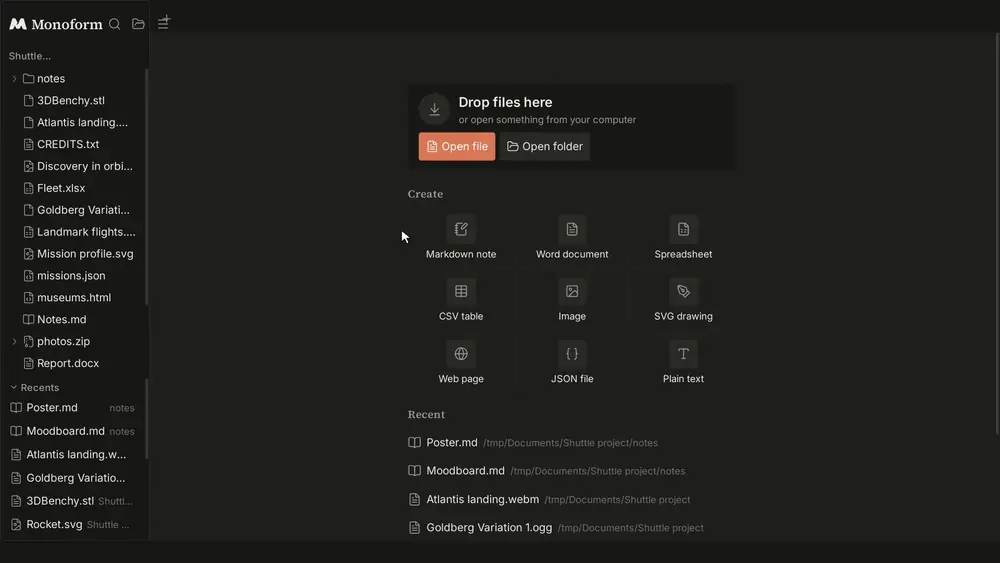</p>

## One window, every file

### Edit pictures without a separate photo app

Layers, selections that snap to edges, colour adjustments limited to what you selected, text, masks and one-click
background removal. Below: *Select subject* finds Space Shuttle Discovery in a NASA photo; copied and pasted into a
note, it is saved next to the note as a cut-out. An optional, offline model makes subject selection sharper and can
**remove objects and fill the gap**.

<p align="center">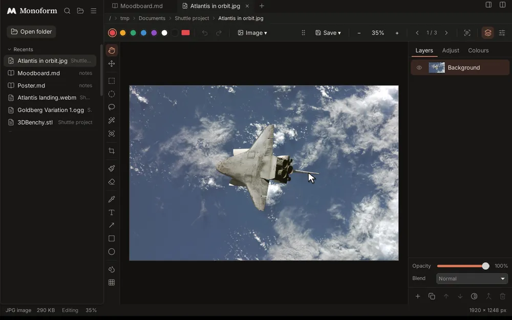</p>

### Write with a live preview

A real code editor (multiple cursors, minimap, Go to symbol) beside the rendered page. Mermaid and Graphviz diagrams
draw as you type; pictures paste straight into `assets/`.

<p align="center">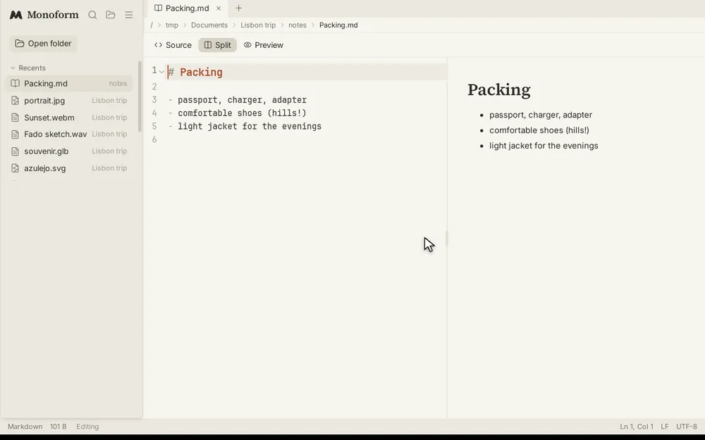</p>

### Everything at hand, side by side

<kbd>Ctrl</kbd>+<kbd>K</kbd> (<kbd>⌘</kbd><kbd>K</kbd> on macOS) finds any command, file name or text inside files. Split the window into
two, three or four views and keep a note, a PDF, a picture and a model open together.

<p align="center">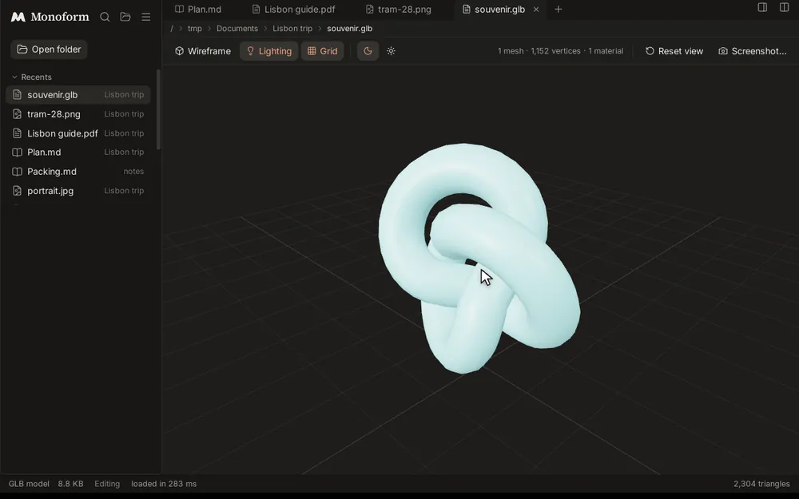</p>

## What it opens

<table>
<tr><td align="center" width="25%">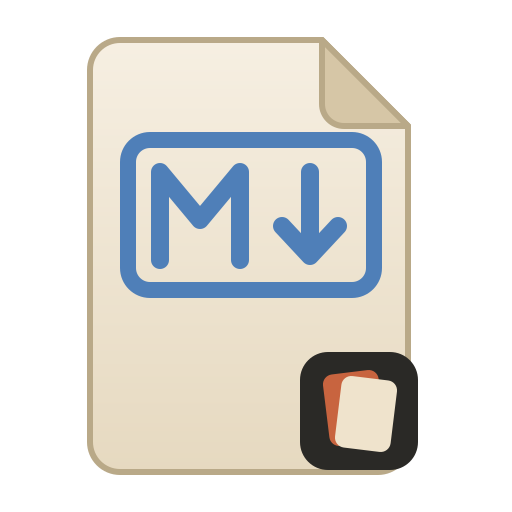<br><b>Notes & Markdown</b><br><sub>Live preview, [[links]] and backlinks, outline, diagrams</sub></td><td align="center" width="25%">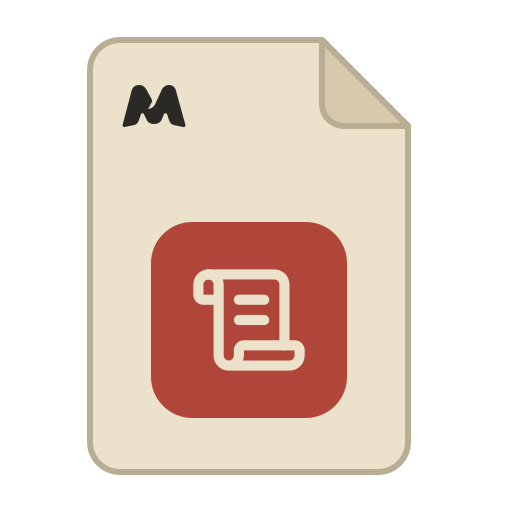<br><b>PDF</b><br><sub>Read, annotate, fill, sign, redact, merge, compress, OCR</sub></td><td align="center" width="25%">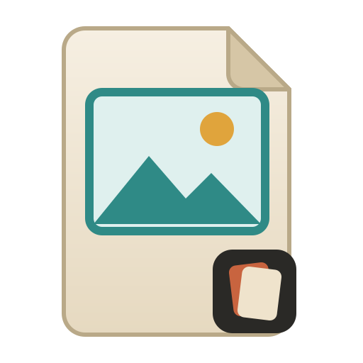<br><b>Images</b><br><sub>Layered editor, selections, adjustments, background removal</sub></td><td align="center" width="25%">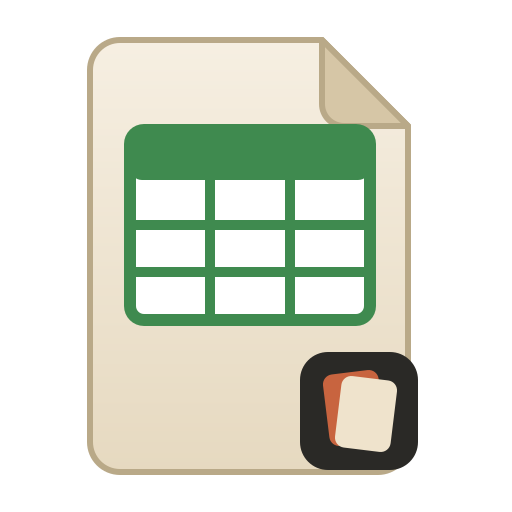<br><b>Spreadsheets & CSV</b><br><sub>Excel, OpenDocument, million-row CSV, formulas</sub></td></tr>
<tr><td align="center" width="25%">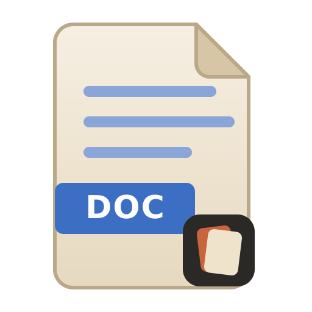<br><b>Word documents</b><br><sub>Edit .docx and .odt in place, open legacy .doc</sub></td><td align="center" width="25%">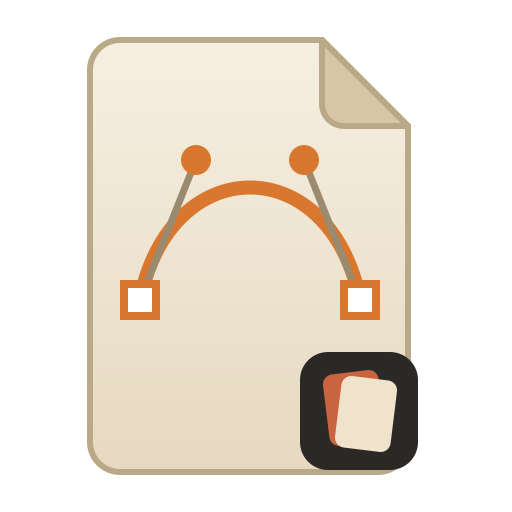<br><b>SVG</b><br><sub>Visual editor or source, export PNG at any size</sub></td><td align="center" width="25%">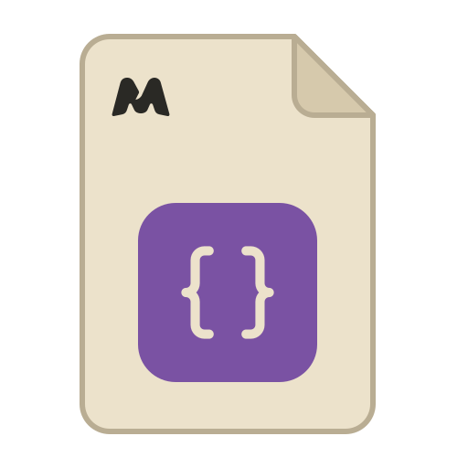<br><b>JSON, YAML, XML…</b><br><sub>Validated trees, logs with live follow, config files</sub></td><td align="center" width="25%">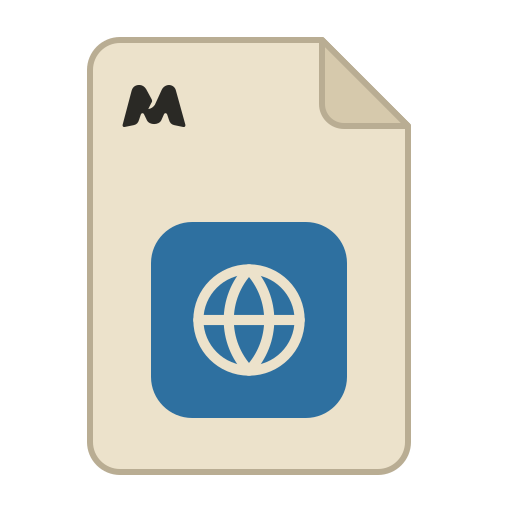<br><b>Web pages</b><br><sub>Safe preview next to the source, scripts off</sub></td></tr>
<tr><td align="center" width="25%">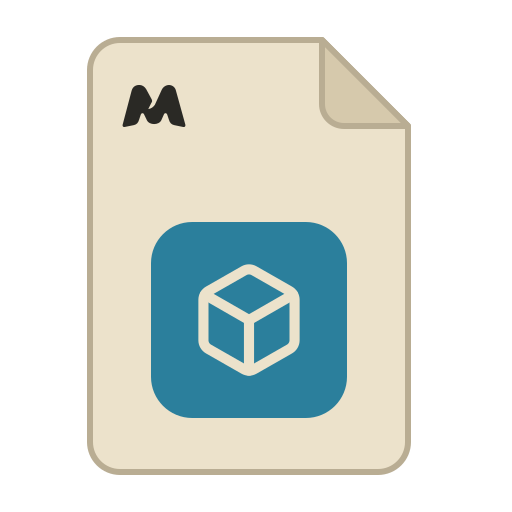<br><b>3D models</b><br><sub>glTF, FBX, OBJ, STL, STEP… parts you can hide or isolate</sub></td><td align="center" width="25%">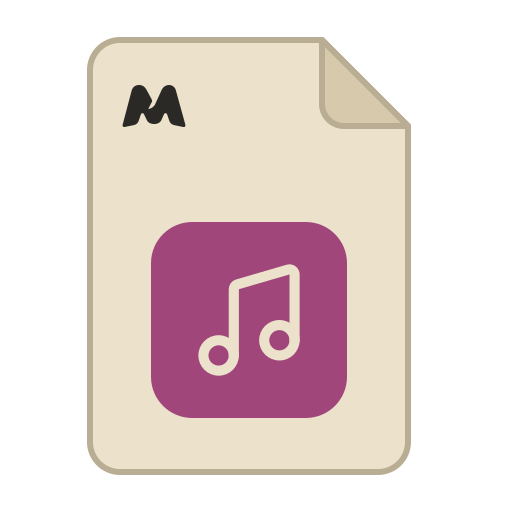<br><b>Audio</b><br><sub>Waveform editing and fades; WAV, FLAC, MP3 without re-encoding</sub></td><td align="center" width="25%">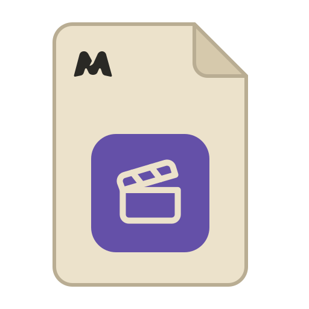<br><b>Video</b><br><sub>Lossless cuts, effects, blur that tracks a moving object</sub></td><td align="center" width="25%">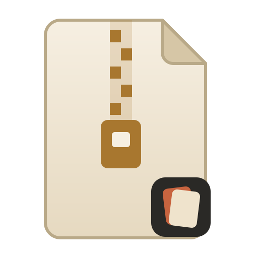<br><b>Archives</b><br><sub>ZIP, 7z, RAR, TAR, ISO, packages — browse and extract</sub></td></tr>
<tr><td align="center" width="25%">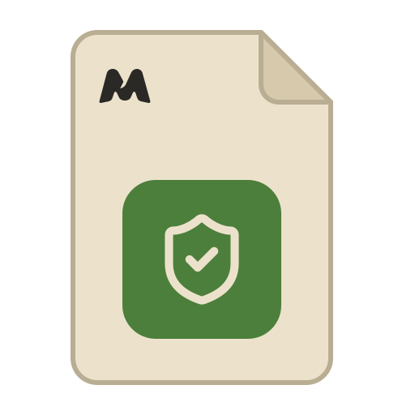<br><b>Hashes</b><br><sub>SHA-256, BLAKE3 and more; verify SHA256SUMS</sub></td><td align="center" width="25%">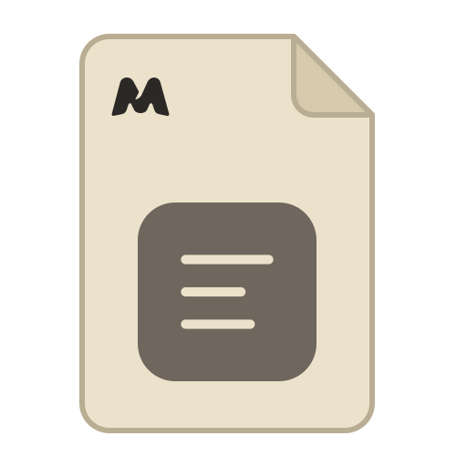<br><b>Everything else</b><br><sub>Plain text in any encoding, compare any two files</sub></td></tr>
</table>

<details>
<summary><b>Everything it does, type by type</b></summary>

| | |
|---|---|
| **Text & Markdown** | Code editor with Sublime-style editing — minimap, Go to symbol (Ctrl+R), multiple cursors (Ctrl+D, Ctrl+Alt+↑/↓, Ctrl+Shift+L), select/duplicate/join/sort lines, case changes, auto-closed brackets, word completion, indent guides — and byte-exact round-trips across encodings and line endings, find/replace, split/preview Markdown, image paste into `assets/`, folder search. Notes link like in Obsidian: `[[Note]]`, `[[Note#Heading|label]]` and relative links (with `[[` completing note names, Ctrl+click to follow, a click on a missing note creating it), a side panel with the outline, backlinks and outgoing links, and word and character counts (also of a selection) in the status bar. |
| **PDF** | Fast viewer with search and thumbnails; highlight, text and drawing annotations in any colour; write on it like in a notebook: a marker, lines, arrows, rectangles and ellipses, a stroke eraser, colour swatches and thin/medium/thick, and blank, lined, squared or dotted pages to insert; form filling; sign (draw, type or import a signature, place and resize it); redact for real (boxes or every search match); compress; reorder, rotate, delete, extract, merge, split; export pages as images; create a PDF from images or add images as pages; read the text of scanned pages (OCR) and make scans searchable. |
| **CAD drawings** | DXF viewer and light editor: layers, blocks, hatches, splines, texts; select (window/crossing), measure, draw lines, polylines, rectangles, circles, arcs and text, move/copy/rotate/scale, object snaps, grid, ortho, typed coordinates (`@dx,dy`, `len<angle`); edit properties; saves only what changed; export SVG/PNG. |
| **Data & logs** | JSON, YAML, TOML, XML and JSON Lines as a tree with validation (and as a table for lists of records); log files with coloured levels, level counts, filters, next error and live follow (tail -f). |
| **Config & certificates** | INI, .properties and .env as an editable table (duplicates flagged, secrets masked); certificates and keys (PEM, DER, PKCS#12, PKCS#7, CSR): issuer, expiry, names, fingerprints, chain. |
| **Databases** | SQLite files: browse tables and views (100k+ rows), sort, search, filter with WHERE, edit cells and rows with Save/Revert in one transaction, see the structure, run SQL with completion, export CSV. |
| **Compare** | Any two files side by side: text and code with word-level changes and change navigation; JSON/YAML as a list of changed paths; CSV rows matched by key; images by swipe, onion skin or a pixel difference; other files byte by byte. |
| **Workspace** | Split view: 2–4 tabs side by side (Ctrl+\\, the split button, or drag a tab onto a view's edge); hide the sidebar for more room (its button, Ctrl+B, or drag its edge away); interface size 80–200 % (Ctrl+Alt+= / −). Every view fits narrow panes: toolbars drop to icons (names on hover) and side panels float over the content. Drag the divider between source and preview (Markdown, HTML, diagrams, SVG) or between split tabs; double-click for equal sizes. The ☰ menu groups commands into submenus (New, This file, the open file's own commands, View, Split view…); Ctrl/Cmd+K finds any command by name. Tabs: **+** for a new tab, drag to reorder, drag a tab out of the window to give it a window of its own. Pictures and text move between tabs: copy and paste, or drag them from one view onto another (a picture or a video frame onto a video, an image, a note or an SVG). A short welcome on first start lets you pick the look (Help › Welcome shows it again). |
| **File history** | Every save keeps the earlier version: `Ctrl+Alt+Y` lists a file's versions to open, compare with the file now, or restore (undoable); *File history: all files* finds deleted files too. Stored locally, size-limited (Settings → File history). |
| **Images** | Layered editor: transparency, selections (rectangle, lasso, magic wand, click an object, select subject — edges snapped to the pixels; move, resize and turn a selection's outline; feather, expand, contract, smooth or border it) with copy/paste, brush/eraser, clone stamp and spot healing brush, gradients, paint bucket, layers you drag to restack, text in any installed font, free rotation, canvas size (add space round the picture, anchored where you choose), skew, distort and perspective, perspective crop and a straighten tool, colour adjustments with Levels and Curves, eighteen effects with a strength each, pixelate and eight kinds of blur (frosted glass among them) (all limited to a selection; blur and pixelate regions previewed with their strength), touchpad and touch-screen pan and pinch-zoom, layer masks (hide parts of a layer without erasing them; paint, invert, from a selection), layer styles (drop shadow, stroke, outer glow), a History panel (jump back several steps at once), rulers, guides, a grid and snapping, one-click background removal (plain backgrounds by colour, keeping thin lines; anything else with a model), watermark clean-up (pale marks or one colour turned white; a selection brush for photos), **remove an object and fill the gap** (optional model), "save a copy", layers saved as OpenRaster (.ora); copy the text out of a screenshot or photo (OCR, offline), or out of just a selected part, and hide it (pixelate every word) in one click; colour picker with HEX/RGB/HSL and the image's palette (copy as CSS, save as .gpl). |
| **More images** | HEIC/HEIF and AVIF (through the system's decoder; convert to JPG, PNG and more); animated GIF and WebP frame editor (timing, reorder, delete, reverse, loop) saving GIF or WebP; ICO/ICNS viewer and maker; font preview (TTF, OTF, WOFF, WOFF2) with metadata, sizes and character map. |
| **SVG & web pages** | Edit SVG visually (select, move, scale, rotate, draw rectangles, ellipses, lines, freehand and text, change colours and any attribute, arrange, outline) or as source with a live preview — visual edits change only the affected attributes in the source; export PNG at any size; open HTML files in a safe preview (scripts and internet content off until you allow them) next to their source. |
| **3D models** | glTF/GLB (incl. Draco), FBX, OBJ+MTL, STL, STEP/STP (CAD assemblies with colours), PLY, 3MF, Collada, 3DS, USDZ, VRML, AMF, PCD, XYZ, VTK — orbit view, a **Parts panel** (an assembly's parts, an STL's separate bodies: click one in the view, hide it, show only it, or see the rest through glass; a parts list with quantities and sizes, copied or saved as CSV), clickable animation list with play/pause/scrub/speed, wireframe and lighting toggles, floor grid, PNG snapshot. |
| **Audio** | Play MP3, WAV, FLAC, OGG (and Opus/AAC where the system can) with cover art and tags; waveform editor: select, cut/copy/paste, delete, trim, silence, fade in/out, volume, normalize, undo; save as WAV or FLAC — or as MP3 without re-encoding after cuts. |
| **Video** | Play MP4, MOV, WebM and MKV (whatever the system can decode) with a thumbnail timeline, frame stepping, speed, A–B loop, full screen and PNG snapshots; cut out parts, trim, rotate (MP4/MOV), remove or extract the audio — saved without re-encoding, so instantly and without quality loss. Effects: image overlays and area blurs (ellipse, rectangle or any drawn shape, optionally inverted; overlays can be masked too) animated with keyframes and timing curves (or pinned to a moving object by tracking), speed changes, transitions and fades, previewed live and rendered to WebM. |
| **Data** | JSON/YAML trees with exact error positions; CSV/TSV grid that stays smooth at a million rows, with sort, filter and Excel-style editing: range selection, copy/paste with Excel, drag to move, fill handle, AutoComplete, undo. |
| **Word & Excel** | Edit `.docx` and `.xlsx` in place (formulas recalculate; the same Excel-style grid as CSV). Word documents get a real editor: lists (bulleted, numbered, nested), fonts, sizes, colours, highlight, alignment, line spacing, headings, links, pictures, tables you can resize and add rows/columns to, page breaks, find and replace, pasting with formatting, and a dark page. OpenDocument `.odt`/`.ods` (LibreOffice) edit and save as themselves, keeping their styles, notes, pictures and comments. Legacy `.doc`/`.xls` open too and save as `.docx`/`.xlsx`. Documents have an outline of their headings to jump around in, and word and character counts. |
| **Screenshots** | Take a screenshot of an area (`Ctrl+Shift+X`), the whole screen or after 3 seconds; it opens ready to mark up with arrows, boxes and text, blur or pixelate faces and passwords. Pick a colour from anywhere on the screen. **Record the screen** (Windows): a window or the whole screen, with the microphone and the computer's sound, pause and a 3-second countdown; a small bar that stays out of the video; saved as MP4 and opened in the video editor to trim. |
| **Diagrams** | Graphviz `.dot` and Mermaid `.mmd` with the source beside the drawing (click a shape to find its line, export SVG/PNG); Mermaid and Graphviz blocks drawn inside Markdown previews. Excalidraw and draw.io drawings open on a canvas you can edit: move, resize, draw shapes, connect them with arrows, freehand, text, colours, pages, undo, SVG/PNG export. In the dark theme drawings and diagrams go dark too, like Excalidraw's dark mode (exports keep their colours). |
| **Languages & updates** | English, Polish, Spanish, German and French — following your system or chosen on first start and in Settings. New versions are offered at startup and install themselves (checked against the release's checksums; off in Settings). Paste anything into an empty tab and it opens as a new document in the right editor. |
| **Archives** | Browse ZIP, TAR(.gz/.bz2/.xz/.zst), 7z and RAR like folders, open files inside, extract safely, create ZIPs. Packages and disk images too: .deb, .rpm, .iso, .msi (with their package details), and .jar/.apk/.ipa/.whl/.nupkg/.vsix/.msix and other zip-based packages. |
| **Hashes** | MD5, SHA-1, SHA-256, SHA-512, BLAKE3 in one pass; paste-to-compare; verify `SHA256SUMS`/`.md5` files. |
| **Save and convert** | Save a file and also get it in another format, next to the original: a Markdown note or Word document as PDF (laid out by Monoform with its own fonts, page numbers and an outline), Word, a web page or text; pictures as JPEG, PNG, WebP, TIFF, icons or PDF; audio as FLAC or WAV; tables (CSV, Excel, OpenDocument, JSON) as Excel, CSV, JSON or a printable PDF. Tick *Also update it every time I save* and the copy stays current. Or convert without opening anything: right-click files in Explorer, Dolphin, Nautilus or Nemo → **Convert with Monoform…** (or Convert… in the sidebar), and `monoform convert IN OUT` in a terminal. |
| **Search everything** | Ctrl/Cmd+K finds commands, file names and text inside files. An optional **search by meaning** (off by default) runs the EmbeddingGemma 2 model locally on your computer. |

Everything is keyboard-reachable: press **Ctrl+K** (**⌘K** on macOS) and type. Right-click anywhere for what you can do there: cut, copy and paste in any text, and each editor's own actions (a table cell, a shape, a selection).

</details>

## Download

Get the latest version from **[Releases](https://github.com/caffeine-runtime/monoform/releases/latest)** (each release lists SHA-256 checksums in `SHA256SUMS`). Builds of unreleased commits are under **Actions → Build → a run → Artifacts**.

- **Windows:** `monoform-amd64-installer.exe` — Monoform's own setup, in the app's look. It installs for you
  (no administrator needed; *For everyone* is an option), and has an **unchecked** option to make Monoform the
  default app for its file types. Without it, the app is still listed under *Open with*. Uninstalling (Settings ›
  Apps) restores the previous defaults. There is also a portable `.zip`. The app uses the WebView2 runtime, which
  the setup installs if it is missing.
- **macOS:** `monoform-macos-universal.zip` contains `Monoform.app` for Apple Silicon and Intel. The build
  is not signed, so the first time, right-click the app and choose **Open**. The app declares its file types at the
  lowest rank, so it appears in *Open With* but never takes over a default. To make it the default, use
  *Get Info → Open with → Change All*.
- **Linux:** `monoform-linux-amd64.tar.gz`. Unpack it and run `./install.sh` to install into `~/.local`, with
  no root needed. The app then appears in *Open With* menus. `./install.sh --set-default` also makes it the default
  for its file types, and `./install.sh --uninstall` removes it. It needs WebKitGTK 4.1 (`libwebkit2gtk-4.1-0`;
  Ubuntu 24.04+, Debian 13, Fedora 40+).

### Quick view and preview mode

On Windows, files you mostly look at **open in a quick view** when Monoform is their default app: pictures (← / → for
the rest of the folder), PDFs, Word documents and Markdown notes to read, songs and videos to play (a song gets a small
player window), 3D models to turn around and look inside. **Edit**, or *Edit with Monoform* on right-click, opens the
full editor; text, data, spreadsheets and archives open in the editor straight away. Any file can be quick-viewed with
right-click → *Quick peek with Monoform*. **Preview mode** (status bar:
*Preview · Edit*, `Ctrl+Alt+E`, or *Settings → Open files in preview mode*) shows any file read-only until you choose
to edit it.

## Build from source

Full setup per OS, all commands, the project layout and its rules: [docs/DEVELOPMENT.md](docs/DEVELOPMENT.md).

Prerequisites:

- Go **1.26.0+**, Node.js **22** with npm
- Wails CLI **v2.17.0**: `go install github.com/wailsapp/wails/v2/cmd/wails@v2.17.0`
- Linux: `sudo apt install libgtk-3-dev libwebkit2gtk-4.1-dev` (or your distro's equivalents)
- Windows: the WebView2 runtime (preinstalled on Windows 10/11)
- macOS: Xcode command-line tools (`xcode-select --install`)

```sh
cd frontend && npm ci && cd ..

# Linux (WebKitGTK 4.1 needs the webkit2_41 tag; scripts/build.sh adds it automatically)
./scripts/build.sh                                   # → build/bin/monoform

# Windows
wails build -platform windows/amd64                 # → build/bin/monoform.exe (setup: see docs/RELEASING.md)

# macOS
wails build -platform darwin/universal               # → build/bin/Monoform.app
```

Development with hot reload: `wails dev` (on Linux: `wails dev -tags webkit2_41`).

## Tests

```sh
go test ./...                       # Go unit tests (Linux: add -tags webkit2_41 for the root package)
cd frontend && npm test             # Vitest
cd frontend && npm run check        # svelte-check / TypeScript
python3 scripts/fixtures.py /tmp/fx && scripts/selftest.sh m4 /tmp/fx   # in-app self-tests (Linux)
```

The self-tests drive the real app inside its webview. [docs/TESTING.md](docs/TESTING.md) lists every scenario
and the manual checklist. CI runs the checks, the Linux self-tests with external verifiers (qpdf, poppler, 7z), and
builds all three platforms on every push to `main` and on pull requests.

## Privacy

Monoform connects to the internet only when you ask it to, with one exception: when it starts, it asks GitHub whether
there is a newer version (a single request to the public releases API; nothing about you, your files or this computer
is sent). Turn it off in *Settings › About*. A new version is downloaded only after you choose **Download and
install**, and checked against the release's SHA-256 sums before it replaces the app. Everything else happens only
when you ask: the optional models — *search by meaning* (about 200 MB, Apache-2.0) and, for the image editor, *Better
subject selection* (BiRefNet, MIT, about 210 MB) and *Object removal* (Moebius, Apache-2.0, about 1.2 GB) with the
ONNX Runtime library they run on (MIT, 6–13 MB, from Microsoft's NuGet package) — and a web page's images, fonts and
styles once you allow them in its preview. Each model is downloaded once after you agree, checked against fixed
SHA-256 sums, and runs on your computer only while you use it. Your files never leave your computer. Settings live in
your OS config folder (`Monoform/settings.json`). The optional models and search indexes live in the OS cache folder
and can be removed from the app (Settings › Add-ons, which can also download them all at once).

## Documentation

- [PROGRESS.md](PROGRESS.md): milestones, measured performance, known issues
- [docs/DECISIONS.md](docs/DECISIONS.md): design decisions and the license of every dependency (all permissive;
  `scripts/licenses.py` audits the built binary and the bundled npm packages)
- [docs/TESTING.md](docs/TESTING.md): automated scenarios and the manual checklist
- [docs/DEVELOPMENT.md](docs/DEVELOPMENT.md): tools to install, commands, layout and rules for contributors

## Licence

[MIT](LICENSE). Monoform uses permissively licensed components only.

## Gallery

<table>
<tr><td width="25%" align="center"><a href="docs/screenshots/pdf.png">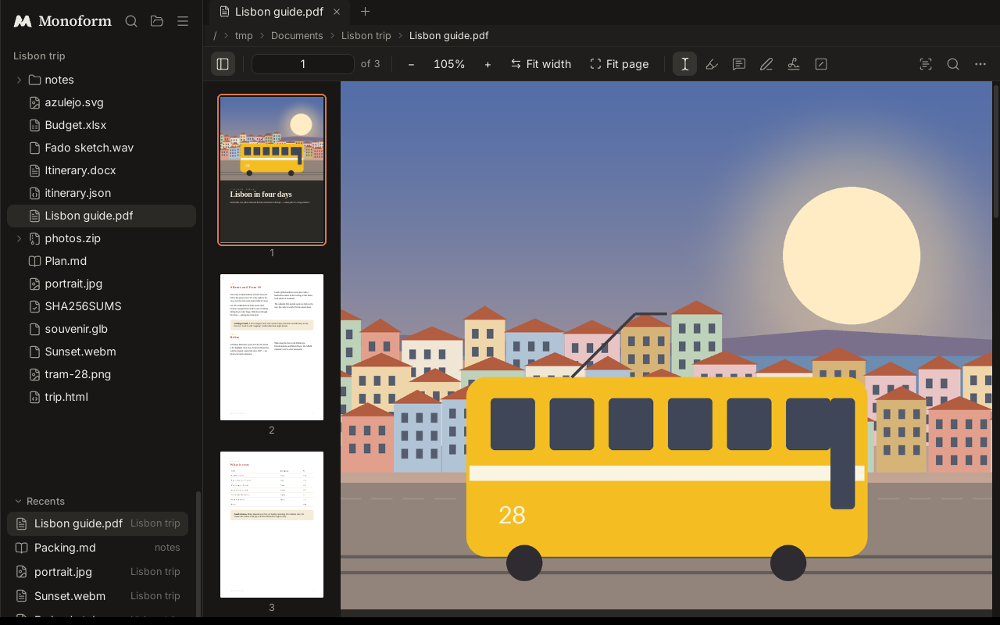</a><br><sub>PDF</sub></td><td width="25%" align="center"><a href="docs/screenshots/word.png">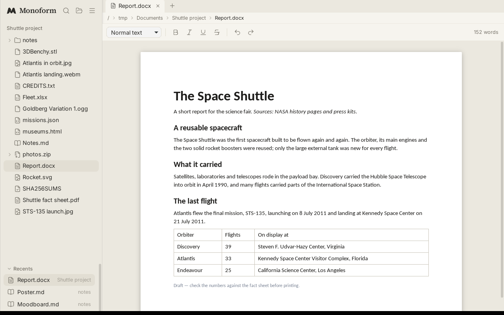</a><br><sub>Word document</sub></td><td width="25%" align="center"><a href="docs/screenshots/spreadsheet.png">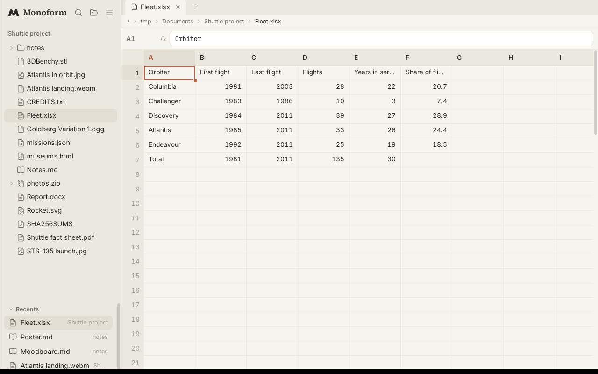</a><br><sub>Excel, formulas calculated</sub></td><td width="25%" align="center"><a href="docs/screenshots/compare.png">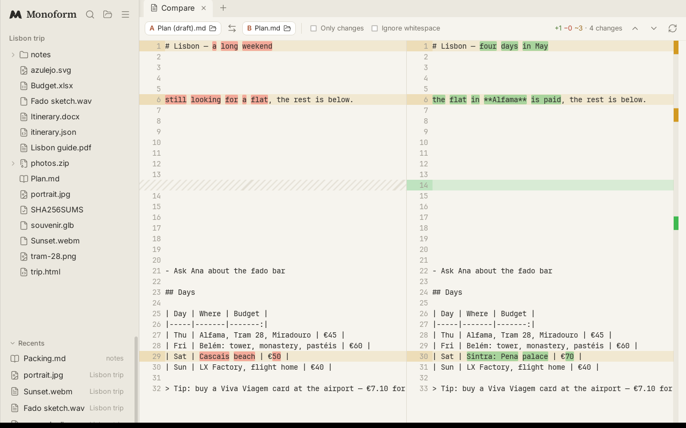</a><br><sub>Two versions compared</sub></td></tr>
<tr><td width="25%" align="center"><a href="docs/screenshots/svg.png">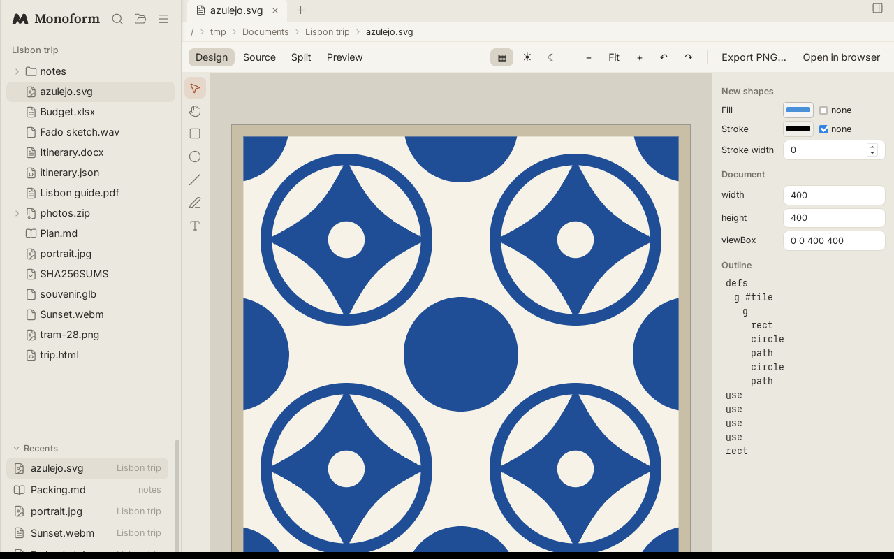</a><br><sub>SVG editor</sub></td><td width="25%" align="center"><a href="docs/screenshots/model3d.png">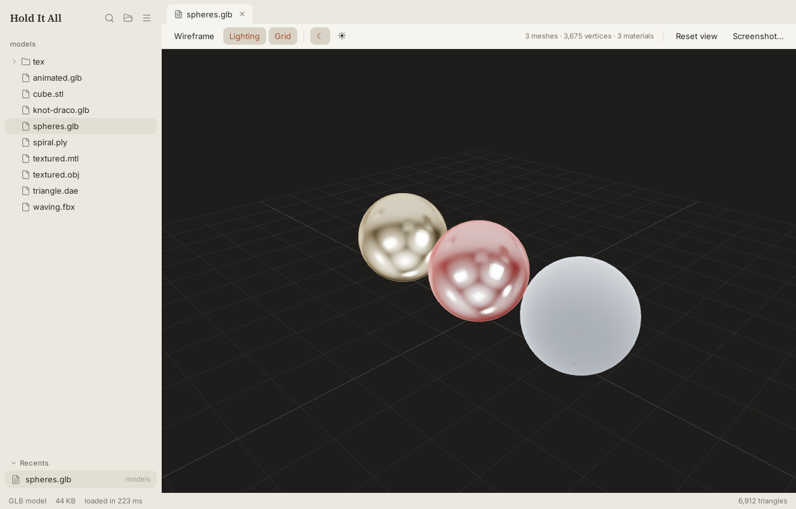</a><br><sub>3D model (STL)</sub></td><td width="25%" align="center"><a href="docs/screenshots/audio.png">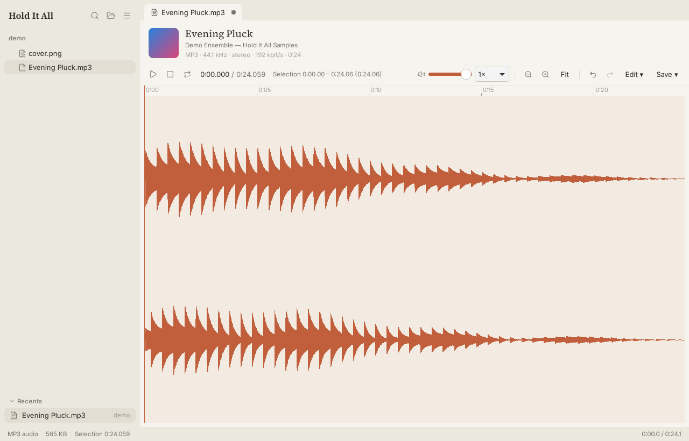</a><br><sub>Audio editor</sub></td><td width="25%" align="center"><a href="docs/screenshots/video.png">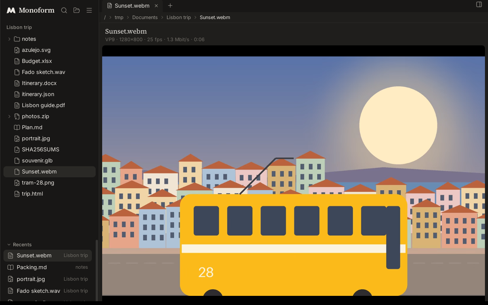</a><br><sub>Video</sub></td></tr>
<tr><td width="25%" align="center"><a href="docs/screenshots/json.png">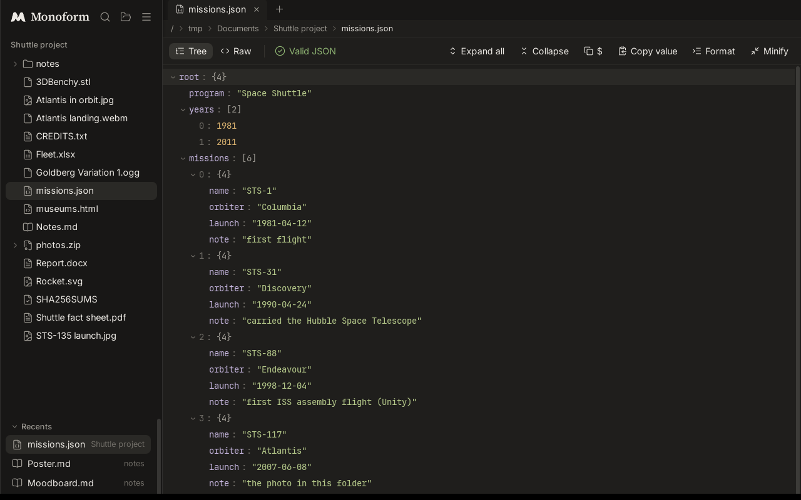</a><br><sub>JSON tree</sub></td><td width="25%" align="center"><a href="docs/screenshots/html.png">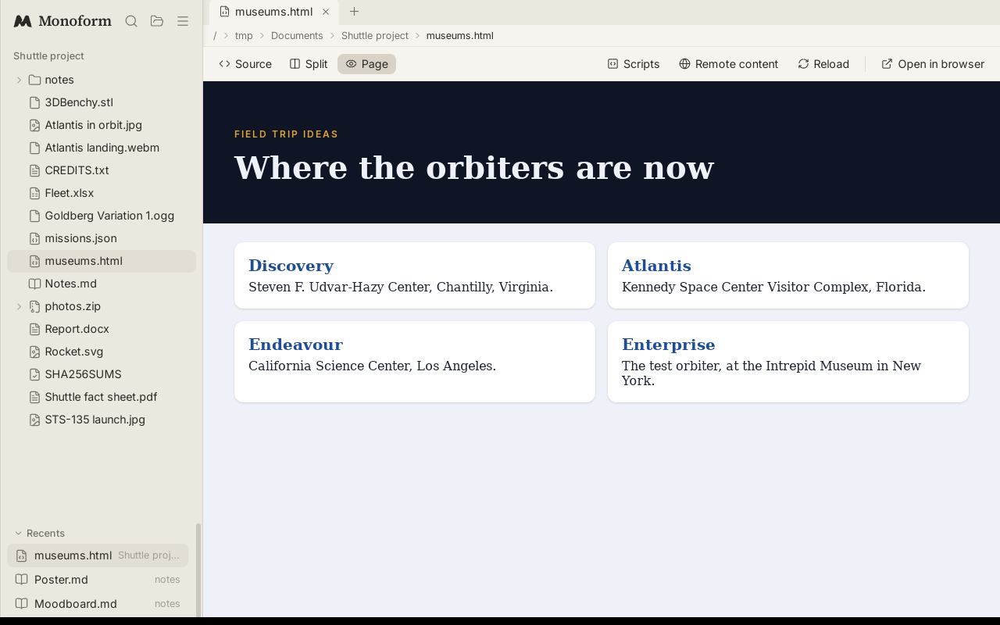</a><br><sub>Web page preview</sub></td><td width="25%" align="center"><a href="docs/screenshots/archive.png">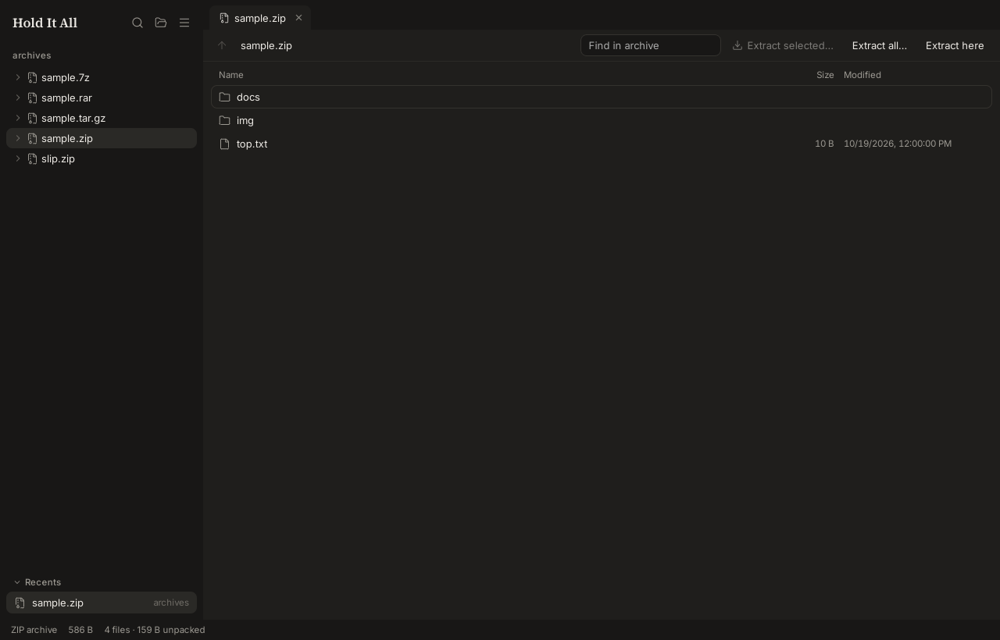</a><br><sub>Inside a ZIP</sub></td><td width="25%" align="center"><a href="docs/screenshots/settings.png">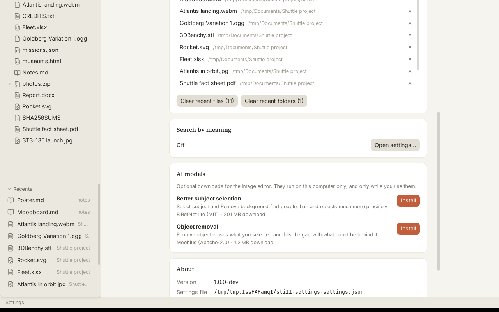</a><br><sub>Settings and add-ons</sub></td></tr>
</table>

<sub>Shown in the clips and screenshots: photos and footage of Space Shuttles Atlantis and Discovery by NASA (public
domain: ISS015-E-12854, ISS018-E-043308, JSC2011-E-067588, KSC-09-S-00143); [#3DBenchy](https://www.3dbenchy.com) by Creative Tools (public
domain, CC0); Bach's Goldberg Variations played by Kimiko Ishizaka, *The Open Goldberg Variations* (CC0); the rocket
from Microsoft's [Fluent Emoji](https://github.com/microsoft/fluentui-emoji) (MIT).</sub>
